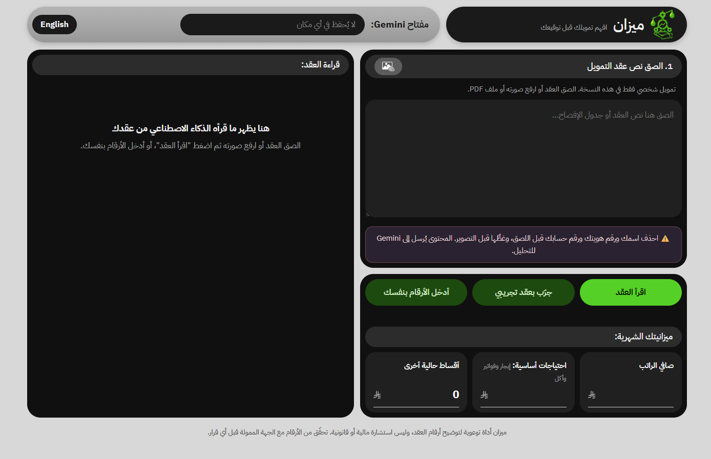
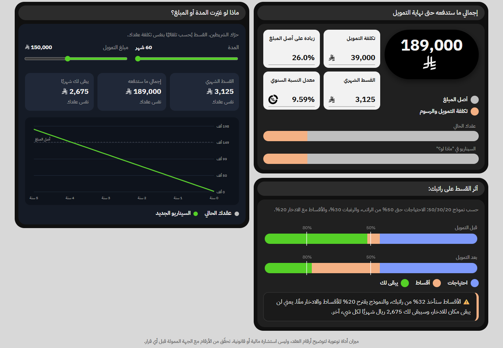

# ميزان | Mizan

افهم عقد تمويلك الشخصي قبل أن توقّعه، بلغة بسيطة وأرقام واضحة.

ميزان أداة تساعد أي عميل على فهم عقد التمويل الشخصي قبل أن يوقّعه. يقرأ الذكاء الاصطناعي (Gemini) العقد من نص أو صورة أو PDF، فيستخرج أرقامه، ويترجم بنوده إلى العامية، ويشرح البنود التي تستحق الانتباه. ثم يحسب ميزان التكلفة الحقيقية للتمويل وأثر القسط على الراتب حسب قاعدة 50/30/20.

## المشكلة

عقود التمويل تُكتب بلغة قانونية صعبة، وكثير من العملاء يوقّعون وهم لا يعرفون كم سيدفعون فعلًا حتى آخر قسط، ولا ماذا تعني بنود مثل السداد المبكر أو التأخر في السداد. والفرق بين هامش الربح المعلن ومعدل النسبة السنوي يربك أغلب الناس.

المستخدم: أي شخص وصله عرض تمويل شخصي أو عقد، ويريد أن يفهمه قبل التوقيع.

## الحل وكيف يعمل الذكاء الاصطناعي فيه

- **التقنية:** نموذج جاهز عبر Gemini API (نموذج Flash من الطبقة المجانية)، ويعمل مباشرة من المتصفح.
- **ماذا يدخل:** نص العقد، أو صورة له، أو ملف PDF.
- **ماذا يخرج من Gemini:** أرقام العقد (المبلغ، والمدة، والقسط، ومعدل النسبة السنوي، والرسوم)، وخلاصة العقد، وترجمة كل بند إلى العامية، والمصطلحات، والبنود التي تستحق الانتباه، وأسئلة يسألها العميل للجهة الممولة.
- **مراجعة الإنسان:** الأرقام المستخرجة تظهر في خانات قابلة للتعديل، ويراجعها المستخدم قبل الحساب.
- **الحسابات بـ JavaScript وليس بالنموذج:** إجمالي ما سيدفعه، وتكلفة التمويل، وأثر القسط على الراتب، وسيناريوهات «ماذا لو؟» عند تغيير المدة أو المبلغ. النموذج قد يخطئ في الحساب بثقة، لذلك يقتصر دوره على القراءة والشرح.

## رابط التجربة

   https://alphah-09.github.io/mizan/

## طريقة التشغيل

- افتح الرابط من الكمبيوتر أو الجوال.
- الصق مفتاح Gemini API الخاص بك في الخانة أعلى الصفحة. تحصل عليه مجانًا من [Google AI Studio](https://aistudio.google.com). المفتاح لا يُحفظ في أي مكان.
- الصق نص العقد أو ارفع صورته، ثم اضغط «اقرأ العقد».
- أو اضغط «جرّب بعقد تجريبي» لتجربة الأداة كاملة بعقد وهمي، وتعمل حتى بدون مفتاح.
- أو اضغط «أدخل الأرقام بنفسك» لاستخدام الحسابات فقط.
- الصفحة تدعم العربية والإنجليزية من زر اللغة.

بدون مفتاح تظهر الصفحة وتعمل الحسابات والعقد التجريبي، لكن قراءة العقود الحقيقية بالذكاء الاصطناعي تحتاج مفتاحًا.

## لقطات من المشروع

<!-- ارفع صورتين أو ثلاثًا إلى المستودع، ثم غيّر أسماء الملفات هنا -->

## حدود المشروع

- **الترجمة العامية للتوضيح فقط:** قد يبسّط النموذج بندًا فيغيّر معناه قليلًا، لذلك يوجد تحت كل بند زر «النص الأصلي»، والعقد الأصلي هو المرجع.
- **استخراج الأرقام قد يخطئ،** خاصة من الصور غير الواضحة، لذلك تظهر الأرقام للمراجعة قبل الحساب.
- **التمويل الشخصي فقط** في هذه النسخة. تمويل السيارات (الدفعة الأخيرة) والتمويل العقاري (النسبة المتغيرة) يحتاجان حسابات مختلفة.
- **الخصوصية:** النص يُرسل إلى Gemini، وبيانات الطبقة المجانية قد تستخدمها Google، لذلك تطلب الصفحة حذف الاسم ورقم الهوية والحساب قبل اللصق.
- **ليست استشارة مالية أو قانونية،** بل أداة توعوية.

**تطوير مستقبلي:** مقارنة عرضين من جهتين مختلفتين جنبًا إلى جنب، ودعم تمويل السيارات والتمويل العقاري.

## صاحب المشروع

اسمك هنا — البرنامج التأسيسي في الذكاء الاصطناعي، مركز أثر للتدريب
